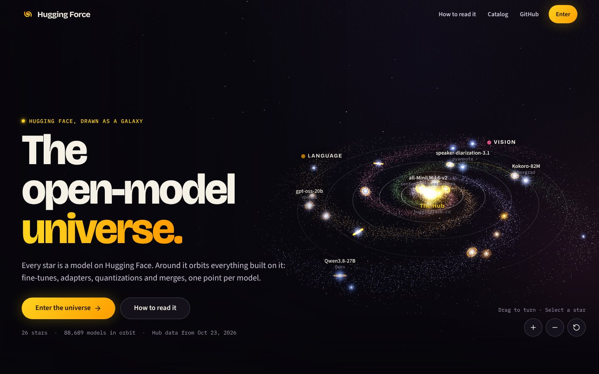
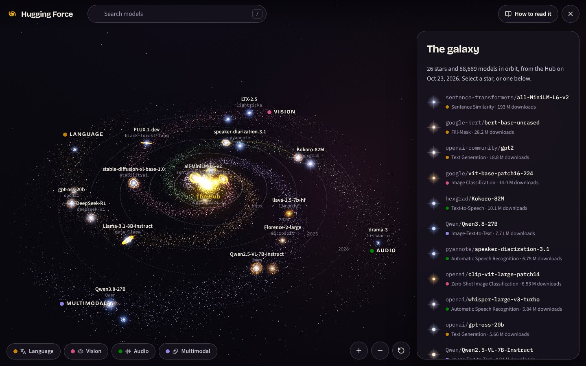
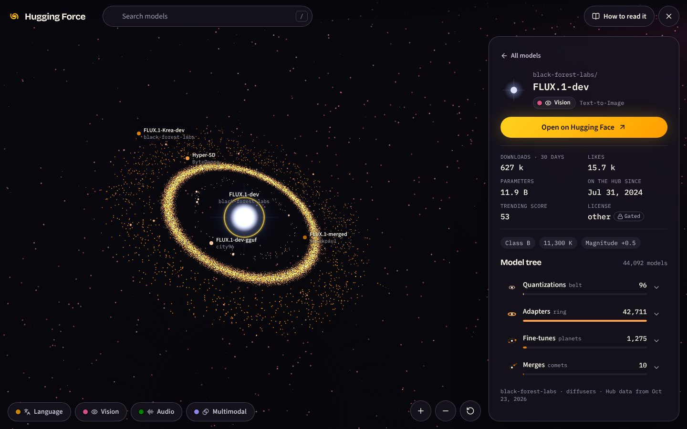
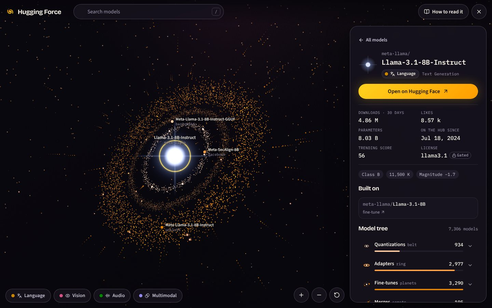
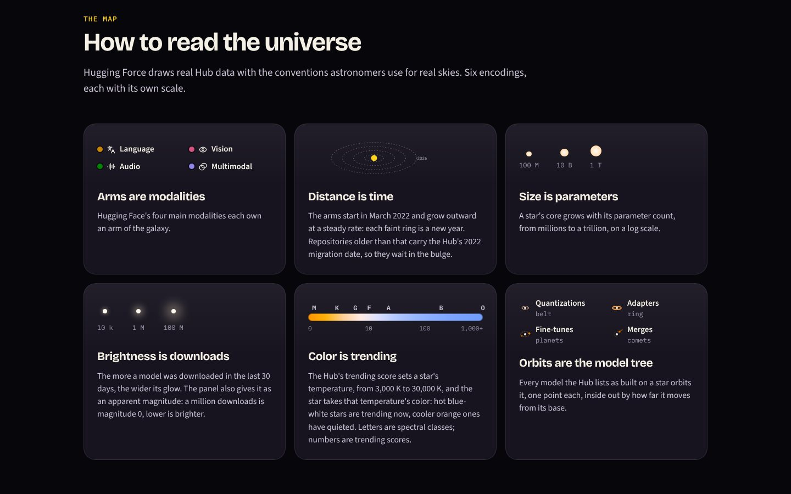
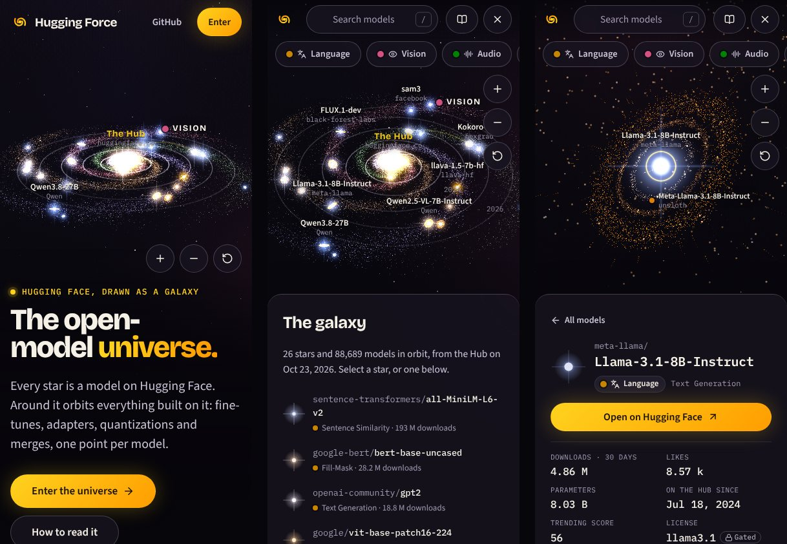

<div align="center">



# Hugging Force

**The open-model universe: the Hugging Face Hub as a galaxy you can fly through.**

Every star is a model on Hugging Face. Around it orbits everything built on it (fine-tunes, adapters,
quantizations and merges), one point per model.

[Concept](#the-universe) · [Run it](#run-it) · [The data](#the-data) · [Design system](#the-design-system) · [Docs](#documentation)

</div>

<br>

<table>
  <tr>
    <td width="50%"><br><sub><b>The galaxy.</b> Four arms, one per modality; each faint ring is a year.</sub></td>
    <td width="50%"><br><sub><b>FLUX.1-dev.</b> 42,711 adapters form its ring.</sub></td>
  </tr>
  <tr>
    <td><br><sub><b>Llama 3.1 8B Instruct.</b> Belt, ring, planets and comets: its whole model tree.</sub></td>
    <td><br><sub><b>How to read it.</b> Six encodings, each with its own scale.</sub></td>
  </tr>
</table>

## What it is

Hugging Force is a proof of concept for a UI layer over the Hugging Face Hub. The Hub is an open
index; Hugging Force draws a handful of its models as a universe, with the conventions astronomers
use for real skies, and keeps every number traceable to the Hub's API.

It is a sibling of [portfolio-map-3d](https://github.com/fritzhand/portfolio-map-3d) and its Nexus
(engineering habits: render on demand, a validated data contract, the address as the state) with
its own universe and design system, built around Hugging Face's yellow and orange.

## The universe

| What you see | What it means | Scale |
|---|---|---|
| **An arm** of the spiral | One of Hugging Face's four main modalities: Language, Vision, Audio, Multimodal | The Hub's own task taxonomy |
| **Distance from the core** | Time on the Hub: the arms start in March 2022 and grow outward at a steady rate; each faint ring is a year | Linear in time |
| **The bulge** | Models older than March 2022 (the Hub dates them all 2022-03-02, its migration date) | Unknown true age |
| **A star's size** | Its parameter count | Log, 10 M to 1 T |
| **A star's glow** | Its downloads in the last 30 days, also given as an apparent magnitude (1 M downloads = magnitude 0) | Log, Pogson's scale |
| **A star's color** | Its trending score, as a temperature (3,000 K to 30,000 K) drawn as that blackbody's color, with its spectral class | Log |
| **What orbits a star** | Its model tree, one point per model the Hub lists: quantizations in a belt, adapters in a ring, fine-tunes as planets, merges as comets | Inside out by how far a derivative moves from its base |
| **A gold arc between stars** | A model and its base model, when both are stars here | |

Select a star to fly to its system: the panel shows its numbers, its base model and the five most
downloaded members of each family, with links to the Hub. Search with `/`, focus an arm, read the
legend, or hide the panel to give the universe the whole screen. Every model is also in the list, so
nothing needs the 3D view.

[docs/universe.md](docs/universe.md) has every formula and constant.

## Run it

Node 22.18 or later.

```bash
npm install
npm run dev          # http://localhost:5190
npm test             # unit tests (layout, Kepler, blackbody, scales, catalog, tokens, labels)
npm run build        # validates the catalog and the tokens, type-checks, builds dist/
```

| Address | What it shows |
|---|---|
| `/` | The landing page; its hero is the live galaxy |
| `/?universe` | The universe, full screen |
| `/?universe&model=<hub id>` | Flown to a model's system, its panel open |
| `/?universe&arm=<nlp\|cv\|audio\|multimodal>` | One arm in focus |

`dist/` is static: deploy it to any static host.

## The data

`src/data/catalog.json` is a snapshot of the Hugging Face Hub API, written by one script:

```bash
npm run catalog      # re-fetches every model in data/curated.json (about a minute; no token needed)
npm run validate     # checks the catalog (also runs before every build)
```

A scheduled GitHub Action (`.github/workflows/refresh-catalog.yml`) does this every day at 09:17 UTC:
it fetches, validates, tests and builds, then commits the new snapshot to `main`, which redeploys the
site. A failed run commits nothing, so the site keeps the last good data. Run it any time from the
Actions tab ("Refresh catalog" → "Run workflow").

- **The handful of models** is `data/curated.json`: 26 ids picked by hand across modalities and years.
  Everything else comes from the API.
- **The model tree** is the Hub's own: for each relation (`finetune`, `adapter`, `quantized`,
  `merge`) the script pages through `base_model:<relation>:<id>` and counts every model, the same
  lists a model page links to (checked against Llama 3.1 8B Instruct's model tree on the Hub).
- **Named derivatives** are the five most downloaded of each family, skipping models marked
  `not-for-all-audiences` and names that advertise adult content or removed safety tuning (they
  still count).
- **The arms** come from Hugging Face's task taxonomy (`data/tasks.json`, copied from
  [huggingface.js](https://github.com/huggingface/huggingface.js/blob/main/packages/tasks/src/pipelines.ts)).
- Nothing is typed in by hand. Unknown stays unknown: a model without parameter metadata reads
  "Not reported".

## The design system

**Warm Cosmos**: Hugging Face's brand yellow `#FFD21E` and orange `#FF9D00` as starlight on a deep
violet sky. One tokens file in the [Design Tokens Community Group format 2025.10](https://www.designtokens.org/tr/2025.10/format/),
`design/hugging-force.tokens.json`, generates the page's CSS variables and the 3D scene's colors
(`npm run tokens`). Bricolage Grotesque for headings, Source Sans 3 and IBM Plex Mono (Hugging
Face's own families) for text and model ids. The arm palette and the orbit ramp were checked for
color-blind separation, every text color is tested at 4.5:1 or more, and color is never the only cue.
[docs/design-system.md](docs/design-system.md) has the details.



## How it is built

Vite, React 19, TypeScript and three.js; no other runtime dependencies besides lucide icons.

```
data/            curated.json (the stars), tasks.json (Hugging Face's task taxonomy)
design/          hugging-force.tokens.json (the design system's single source)
scripts/         fetch-catalog, validate-catalog, build-tokens
src/data/        the catalog (generated), its types, its validator
src/lib/         pure, tested logic: galaxy (layout), kepler (orbits), blackbody (star colors),
                 scales (size, glow, temperature, magnitude), universe (catalog to bodies),
                 search, route, format
src/three/       engine (the scene), shaders, paint (canvases), labels (DOM labels, declutter),
                 cpuCanvas, contextWatch, webgl
src/components/  Landing, Universe (HUD), ModelPanel, Legend, Catalog, SearchBox, icons
src/styles/      tokens.css (generated), base, landing, universe
```

- **One body per derivative** (about 89,000 points), each on a Kepler orbit solved in the vertex
  shader, so the CPU uploads static buffers once and only the time changes.
- **Render on demand**: up to 30 fps while orbits turn, 60 during a flight or a drag, nothing while
  hidden or off screen. Under `prefers-reduced-motion` nothing moves by itself.
- **No network assets in 3D**: the sky, glows and rings are painted on canvases; labels are DOM.
- **WebGL context loss** is handled (repaint on restore, rebuild if none comes); without WebGL 2 the
  page and the list still work.

## Documentation

| | |
|---|---|
| [docs/universe.md](docs/universe.md) | The universe protocol: every encoding, formula and constant |
| [docs/research.md](docs/research.md) | The research behind it: Hugging Face's data, open astronomy, open-source 3D, design |
| [docs/design-system.md](docs/design-system.md) | Warm Cosmos: tokens, color, type, components, accessibility |

## Not affiliated

Hugging Force is an independent open-source project. It is not affiliated with or endorsed by
Hugging Face. Hugging Face is a trademark of Hugging Face, Inc. Model data comes from the public
[Hugging Face Hub API](https://huggingface.co/docs/hub/api).

## License

[MIT](LICENSE)
